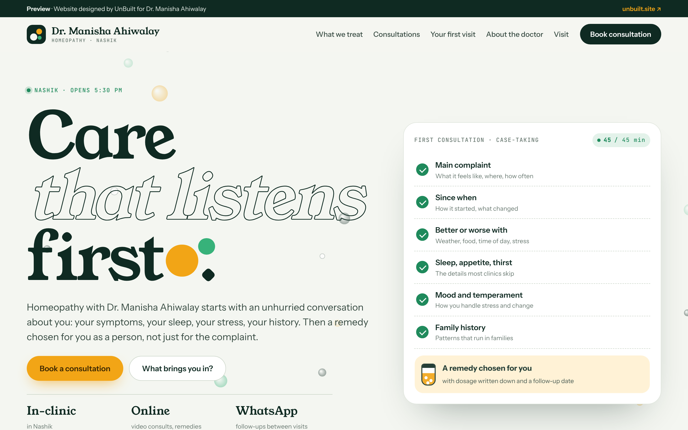

# Clinic website template by UnBuilt

A one-page clinic website, first built for **Dr. Manisha Ahiwalay, homeopathic physician in Nashik**. Made by [UnBuilt](https://unbuilt.site) as a template we adapt for each clinic.



## What's on the page

- **Hero** with an animated case-taking card that ticks through a first homeopathy consultation, and drifting "globules" in the background.
- **What brings you in?** An explorer for skin, allergies, children, women's health, digestion, stress and sleep, and joints, with how a consultation works for each and the usual follow-up schedule.
- **Consultations**: in-clinic, online video, family care, chronic care plans, WhatsApp follow-ups.
- **First visit, step by step**, and an **About the doctor** section.
- **Booking**: pick in-clinic or online, a day and a free slot, then the request opens in WhatsApp with every detail filled in. Without a clinic number it shows a preview of that message.
- **FAQ**, opening hours (today highlighted, India time) and directions.
- Works on phones, with a sticky booking button. Fonts are self-hosted; no tracking.

## Run it

```
npm install
npm run dev      # http://localhost:5173
npm run build    # static site in dist/
```

Every push to `main` deploys to GitHub Pages.

## Make it for another clinic

Edit `src/config.ts`: name, doctor, qualification, area, address, WhatsApp number, hours, the concerns list, consultations and FAQ. Lines marked `EDIT` are placeholders to confirm with the doctor.

Some details can also be set from the link without a rebuild, e.g. `?phone=98XXXXXXXX&area=College%20Road&address=...`.

## Before going live

- Confirm the qualification and registration details, address, hours and WhatsApp number.
- Replace the initials block with the doctor's photo.
- Add real Google reviews only with permission, never invented ones.
- Keep the safety note: homeopathy is taken alongside regular medical care.
